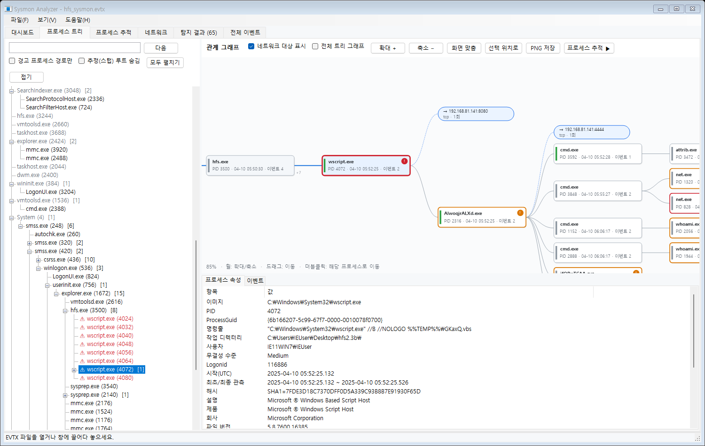
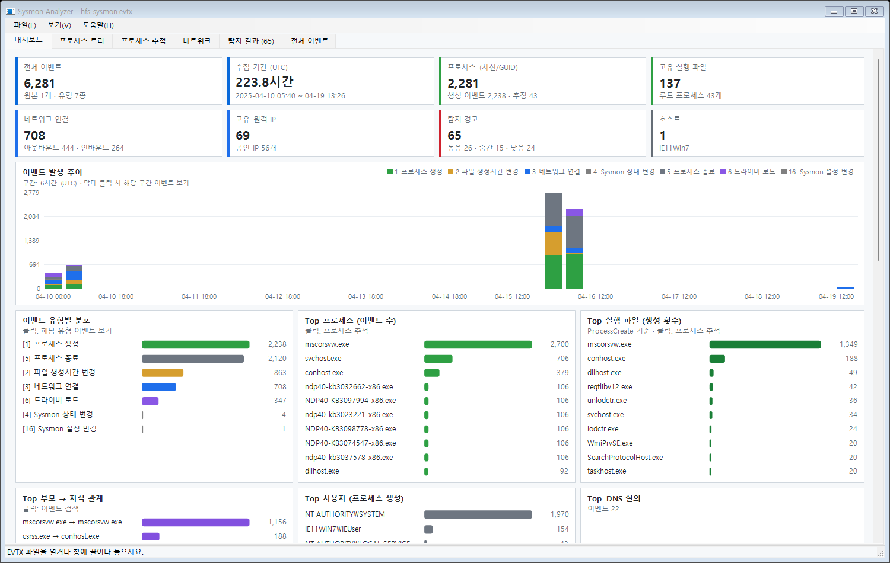
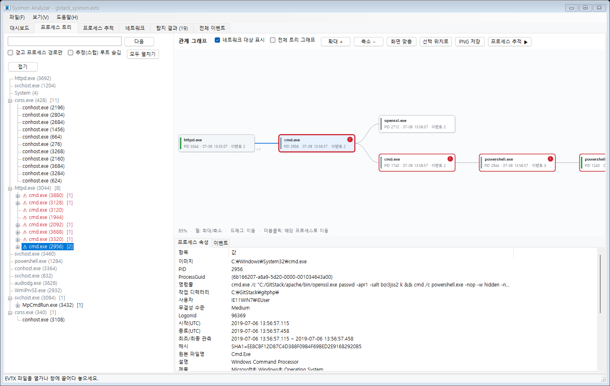
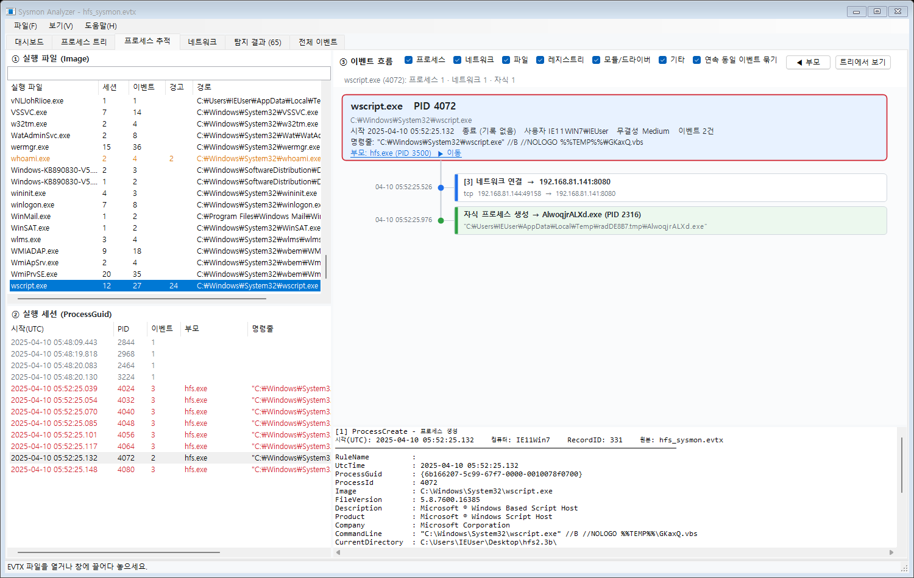
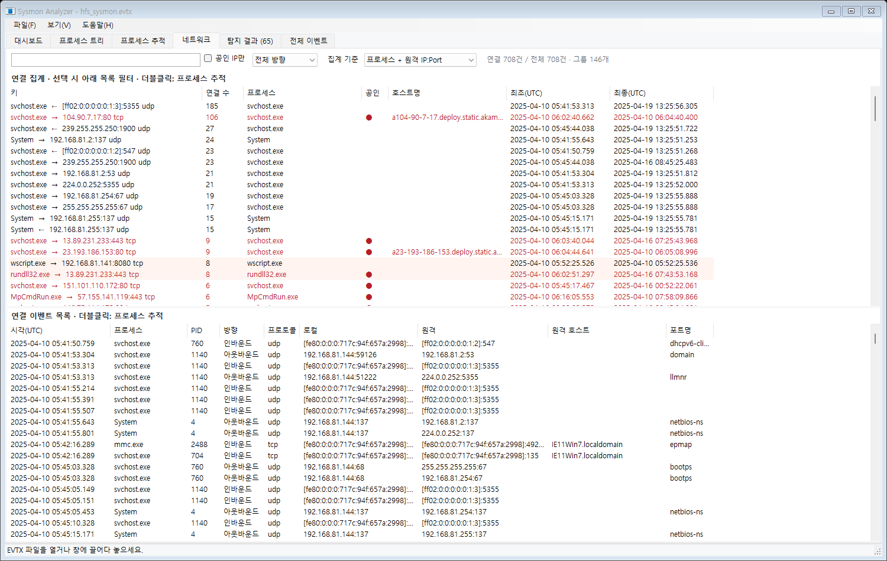
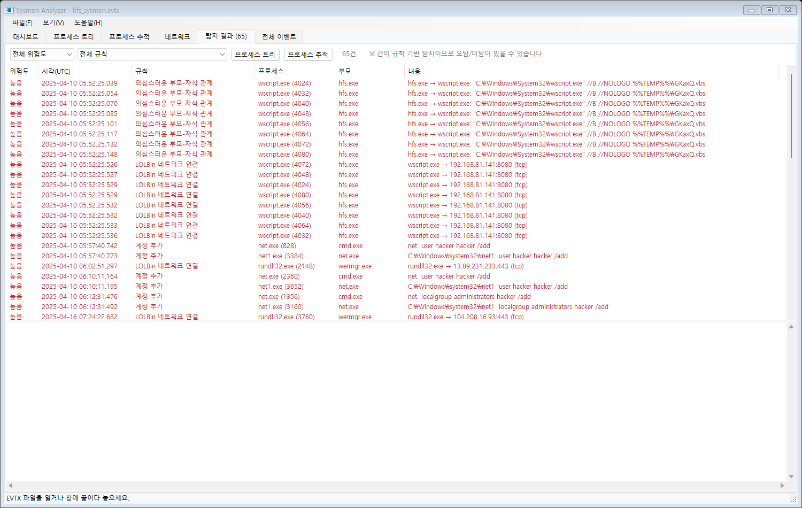
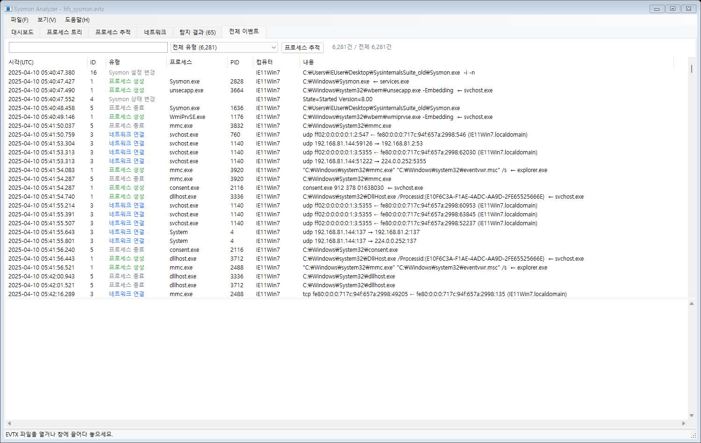

# Sysmon Analyzer

Sysmon 이벤트 로그(.evtx)를 프로세스 단위로 묶어 분석하는 Windows 데스크톱 도구입니다.
부모→자식 프로세스 계보, 프로세스별 행위 흐름, 프로세스·IP·포트 통계, 규칙 기반 탐지를 한 프로그램에서 볼 수 있습니다.

C# (.NET 8, WinForms)로 만들었고, 외부 NuGet 패키지를 쓰지 않습니다.



## 요구 사항

- Windows 10/11
- [.NET 8 SDK](https://dotnet.microsoft.com/download/dotnet/8.0) (빌드), 또는 .NET 8 Desktop Runtime (실행)

## 빌드 / 실행

```powershell
git clone https://github.com/ngnicky-ai/sysmon-analyzer.git
cd sysmon-analyzer
dotnet build SysmonAnalyzer.sln -c Release
.\SysmonAnalyzer\bin\Release\net8.0-windows\SysmonAnalyzer.exe [파일.evtx ...]
```

- **입력 형식**: Sysmon `.evtx`, `wevtutil qe <log> /f:xml` 출력(`.xml`), 로컬 `Microsoft-Windows-Sysmon/Operational` 채널(관리자 권한 필요)을 열 수 있습니다.
- **드래그 앤 드롭**: 파일을 창에 끌어다 놓아도 열립니다. Ctrl을 누른 채 놓으면 기존 데이터에 병합합니다.
- **샘플 열기**: 시작 화면의 **샘플 열기** 버튼은 저장소의 `samples\*.evtx`를 불러옵니다.
- **시간 기준**: 모든 시간은 UTC로 표시합니다.
- **화면 배율**: `Ctrl + 마우스 휠` 또는 `Ctrl + +` / `Ctrl + -`로 70%~250% 사이에서 조절하고, `Ctrl + 0`으로 100%로 되돌립니다. 배율은 `%APPDATA%\SysmonAnalyzer\settings.ini`에 저장되어 다음 실행 때도 유지됩니다.

## 화면 구성

### 대시보드
요약 카드(이벤트, 기간, 프로세스, 실행 파일, 연결, 원격 IP, 경고, 호스트), 유형별 시간 추이, Top 프로세스·실행 파일·부모→자식·사용자·DNS, Top 원격 IP·공인 IP·서비스 포트·IP:Port를 보여 줍니다. 차트 항목을 클릭하면 해당 탭으로 이동합니다.



### 프로세스 트리
ProcessGuid 기준 부모→자식 계층 트리와 관계 그래프입니다. 그래프에는 조상 경로, 하위 트리, 네트워크 대상 노드가 함께 그려집니다.

- **그래프 조작**: 휠로 확대/축소, 드래그로 이동, 더블클릭으로 해당 노드를 중심으로 다시 그리며, PNG로 저장할 수 있습니다.
- **경고 경로만 보기**: 경고가 있는 프로세스와 그 조상만 남깁니다.
- **추정 부모 표시**: 생성 이벤트가 없는 부모는 점선 노드로 추정해 계보가 끊기지 않게 잇습니다.



### 프로세스 추적
SysmonView의 Process View 방식을 따라 실행 파일 → 실행 세션(GUID) → 이벤트 흐름 순서로 좁혀 들어갑니다. 자기 이벤트, 자식 생성, 다른 프로세스로부터의 접근(8/10)을 시간순으로 보여 줍니다.

- **반복 묶기**: 연속된 같은 이벤트는 `×N`으로 묶습니다.
- **분류 필터**: 프로세스, 네트워크, 파일, 레지스트리 등 분류별로 끄고 켤 수 있습니다.



### 네트워크
프로세스+원격 IP:Port, 원격 IP, 서비스 포트, 프로세스 기준으로 연결을 집계하고 원본 연결 목록을 함께 보여 줍니다. `:4444`처럼 포트로 필터링할 수 있고, 공인 IP만 보거나 방향(인/아웃바운드)으로 거를 수 있습니다.



### 탐지 결과
규칙 기반 의심 행위 목록입니다. 위험도와 규칙으로 필터링할 수 있고, 경고를 선택하면 조상 경로와 원본 이벤트가 표시됩니다.



### 전체 이벤트
가상 목록이라 이벤트가 많아도 느려지지 않습니다. 검색어는 공백으로 나누면 AND 검색이 되고, `-단어`는 제외 검색입니다. 컬럼을 클릭하면 정렬되고, 결과를 CSV로 내보낼 수 있습니다.



파일 메뉴에서 **HTML 요약 보고서**(통계, 경고, 경고 프로세스 계층 트리)도 내보낼 수 있습니다.

## 샘플 로그

`samples/` 폴더에 공격이 재현된 테스트 VM(IE11Win7)의 Sysmon 로그 두 개가 들어 있습니다.

| 파일 | 이벤트 | 내용 |
|---|---|---|
| `hfs_sysmon.evtx` | 6,281건 | HFS 웹서버(hfs.exe) → wscript.exe → Temp 실행 파일 → 192.168.81.141:4444 연결 → UAC 우회로 보이는 단계 → `net user hacker /add`, 관리자 그룹 추가 |
| `gistack_sysmon.evtx` | 135건 | GitStack 웹서버(httpd.exe) → cmd.exe → 숨김 PowerShell → 192.168.130.134:4444 리버스 셸 → mimikatz.exe 실행 |

로그에는 실제 공격 명령줄이 들어 있습니다. 그래서 `--snapshot`으로 만든 `report.txt`처럼 명령줄을 텍스트로 저장한 파일은 백신이 악성으로 탐지할 수 있습니다.

## SysmonView와 비교

[SysmonView](https://github.com/nshalabi/SysmonTools)를 참고해 만들었습니다.

| 항목 | SysmonView | Sysmon Analyzer |
|---|---|---|
| 로그 불러오기 | XML로 내보낸 뒤 DB(SQLite)로 가져오기 | EVTX를 바로 열기. 메모리에서 분석하며 샘플(6천여 건)은 수 초 안에 끝남 |
| 프로세스별 흐름 | Process View (이미지 → 세션 → 이벤트) | 같은 3단계 구성에 자식 생성 링크, 부모 이동, 반복 묶기, 분류 필터 추가 |
| 부모-자식 계보 | 세션 단위로 확인 | 계층 트리 + 줌/팬 관계 그래프 + 네트워크 대상 노드 |
| 전체 이벤트 | All Events View | 검색(AND/제외), 정렬, CSV 내보내기 |
| IP 위치(지도) | 지원 | 오프라인 환경을 고려해 넣지 않음. 공인/사설 구분과 호스트명 집계로 대신함 |
| 추가 기능 | - | 통계 대시보드, 규칙 기반 탐지, 인/아웃바운드 추정, HTML 보고서, 화면 배율 |

## 탐지 규칙 (간이)

- **의심스러운 부모-자식 관계**: 오피스, 웹서버(hfs, httpd, w3wp 등), 브라우저가 cmd/powershell/wscript나 정찰 도구를 실행한 경우
- **명령줄 패턴**: PowerShell 인코딩/다운로드/은닉 옵션, certutil·bitsadmin·mshta·regsvr32·rundll32 악용, 섀도 복사본 삭제, 계정 추가, 예약 작업, Run 키, 자격 증명 덤프
- **실행 위치와 통신**: LOLBin의 네트워크 연결, 사용자 쓰기 가능 경로(Temp, AppData, Downloads 등)에서의 실행이나 외부 연결
- **위장**: 시스템 프로세스 이름인데 경로가 비정상인 경우, 부모가 비정상인 svchost
- **기타 이벤트**: 원격 스레드(8), LSASS 접근(10), 서명 없는 드라이버(6), 프로세스 변조(25), WMI 구독(19–21), Sysmon 상태/설정 변경

규칙은 분석을 시작할 지점을 찾기 위한 것이라 오탐과 미탐이 있을 수 있습니다. 규칙은 [Detector.cs](SysmonAnalyzer/Analysis/Detector.cs)에서 추가하거나 수정합니다.

## 구조

```
SysmonAnalyzer/
  Models/     SysmonEvent, ProcessInfo, Alert/NetConnection, EventCatalog(ID별 이름·색·분류·요약)
  Parsing/    EventLoader  - EVTX(EventLogReader, (ID,Version)별 필드명 캐시), XML(인코딩 자동 감지)
  Analysis/   AnalysisResult(프로세스 관계·연결 구성), Detector(탐지), ReportWriter(HTML)
  Controls/   BarChart, TimeHistogram, StatCard, ProcessGraph(관계 그래프), ProcessTimeline(이벤트 흐름)
  Forms/      MainForm + 탭별 View
samples/      실습용 Sysmon 로그
img/          README 화면 캡처
```

검증용 옵션 `SysmonAnalyzer.exe --snapshot <출력폴더> <파일...> [--zoom=1.4]`은 각 탭 화면(PNG), `report.txt`, `report.html`을 저장한 뒤 종료합니다.
